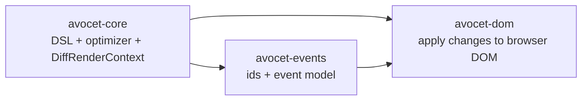
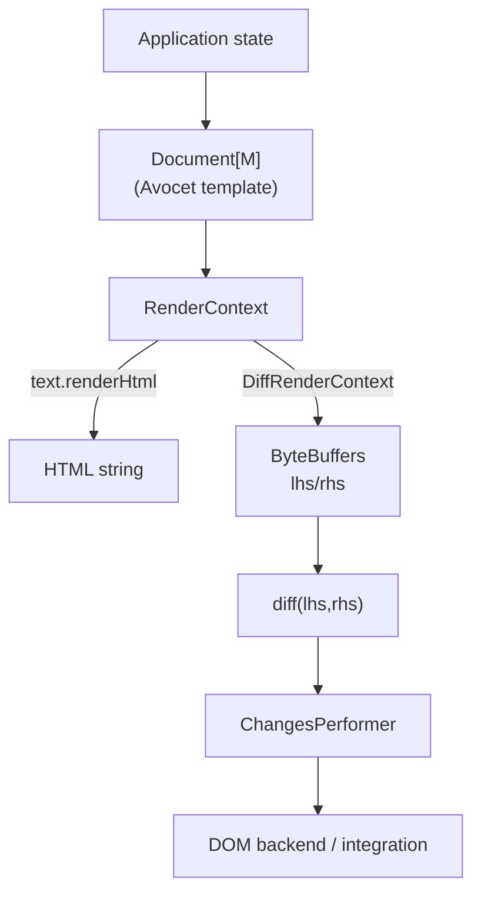
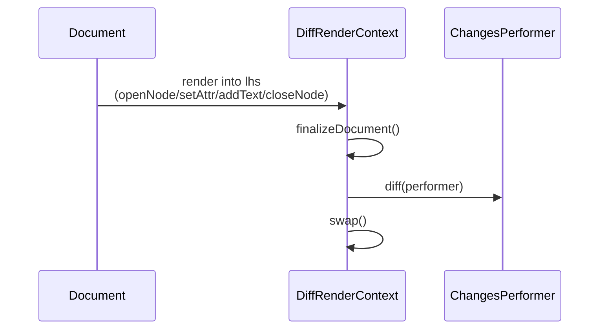

<p align="center">
  
</p>

# Avocet

Avocet is a fast HTML template engine and eDSL for Scala 3. Optimized templates render without allocating a template object tree per render; the render buffers, the node index of a DOM backend and application data are retained (see "Memory allocation model" below).
Avocet supports changeset inference, which allows to use it as virtual-dom-like middleware.

**Requirements:** Scala 3.3+ and JDK 21+.

## Documentation

* [Docs](https://natural-transformation.com/open-source/avocet/overview)

## Static rendering

You can use Avocet as a static HTML renderer.

```scala
// build.sbt
libraryDependencies += "com.natural-transformation" %% "avocet-core" % "2.0.1"
```

```scala
// In your code
import avocet.text.renderHtml
import avocet.dsl._
import html._

val features = Seq("Very fast", "Memory-effective")

val html = renderHtml {
  optimize {
    body(
      div(
        clazz := "title",
        backgroundColor @= "red",
        "Hello, I'm Avocet!"
      ),
      ul(clazz := "list",
        features map { feature =>
          li(class := "item", feature)
        }
      )
    )
  }
}

println(html)
```

```html
<body>
  <div style="background-color: red" class="title">Hello, I'm Avocet!</div>
  <ul class="list">
    <li class="item">Very fast</li>
    <li class="item">Memory-effective</li>
  </ul>
</body>
```

#### Benchmarks

Benchmarks show that Avocet is really fast. Unlike Twirl,
Avocet's performance does not depend on template complexity.

| Test                  | Engine        | Ops/s          |
| --------------------- |:--------------| --------------:|
| simpleHtml            | avocet        |  1,626,672     |
| simpleHtml            | scalatags     |  1,604,833     |
| simpleHtml            | twirl         | 76,749,943     |
| withConditionAndLoop  | avocet        |  1,720,568     |
| withConditionAndLoop  | scalatags     |  1,543,942     |
| withConditionAndLoop  | twirl         |  3,828,345     |
| withVariables         | avocet        |  1,691,589     |
| withVariables         | scalatags     |  1,600,567     |
| withVariables         | twirl         | 19,641,402     |

In your sbt shell.

```
bench / Jmh / run .StaticRenderingComparision
```

## As a virtual DOM

Avocet can be used as virtual-DOM-like middleware. Unlike other popular
virtual DOM solutions, Avocet does not build an object tree for the new
virtual DOM: templates write into a byte buffer and changes are inferred by
comparing two buffers. Memory is bounded by the two render buffers (which
grow with the largest rendered document and shrink again through `trim()`
or a `TrimPolicy`), the DOM backend's node index and the handler table;
`dispose(target)` releases them. Allocation per update is small but not
zero; the measured figures per workload are in
[IMPLEMENTATION-EVIDENCE.md](IMPLEMENTATION-EVIDENCE.md) and
[bench/BASELINE.md](bench/BASELINE.md).

```scala
// build.sbt
libraryDependencies += "com.natural-transformation" %%% "avocet-dom" % "2.0.1"
```

```scala
// In your code
import org.scalajs.dom._
import avocet.dom.render
import avocet.dom.event
import avocet.dsl._
import html._

case class Todo(id: String, text: String, done: Boolean)

def onSubmitClick() = {
  val input = document
    .getElementById("todo-input")
    .asInstanceOf[html.Input]
  val inputText = input.value
  // Reset input
  input.value = ""
  val newTodo = Todo(
    id = Random.alphanumeric.take(5).mkString,
    text = inputText,
    done = false
  )
  renderTodos(todos :+ newTodo)
}

def onTodoClick(todo: Todo) = {
  renderTodos(
    todos.updated(
      todos.indexOf(todo),
      todo.copy(done = !todo.done)
    )
  )
}

def renderTodos(todos: Seq[Todo]): Unit = render(document.body) {
  optimize {
    body(
      div(clazz := "title", "Todos"),
      ul(clazz := "list",
        todos map { todo =>
          li(
            todo match {
              case Todo(_, text, true) => strike(text)
              case Todo(_, text, false) => span(text)
            },
            event("click")(onTodoClick(todo))
          )
        }
      ),
      input(id := "todo-input", placeholder := "New ToDo"),
      button("Submit", event("click")(onSubmitClick()))
    )
  }
}

val todos = Seq(
  Todo("1", "Start use Avocet", done = false),
  Todo("2", "Lean back and have rest", done = false)
)

renderTodos(todos)
```

## Design

Avocet is a small core engine for building and diffing HTML-like trees in Scala. The key idea is: **a template is a function that writes rendering operations into a render context**. Depending on the render context implementation, those operations become either:

- an **HTML string** (static rendering), or
- a compact **byte-buffer encoded tree** that can be **diffed** to infer changes (virtual-DOM-like).

### Modules

- **`avocet-core`**: DSL + optimizer + render contexts (including `DiffRenderContext`)
- **`avocet-events`**: shared event/id model used by integrations
- **`avocet-dom`**: Scala.js DOM backend that applies diffs to the browser DOM



### The render pipeline

At runtime, an Avocet template is a `Document[M]` (usually created via the DSL as `Node[M]`, `Attr[M]`, `Style[M]`). Applying a document means calling methods on a `RenderContext`:

- `openNode(XmlNs, tag)`
- `setAttr(XmlNs, name, value)`
- `setStyle(name, value)`
- `addTextNode(text)`
- `closeNode(tag)`
- `addMisc(value)` (integration side-channel)



### `DiffRenderContext` lifecycle (and why `finalizeDocument()` matters)

`DiffRenderContext` keeps **two internal buffers**:

- **lhs**: the most recently rendered document (current)
- **rhs**: the previous document (baseline)

Diffing is a lifecycle. The important steps are:

1. **Render** by applying a `Document` to the render context (writes ops into **lhs**)
2. Call **`finalizeDocument()`** (flip lhs for reading + reset traversal state)
3. Call **`diff(performer)`** (read lhs/rhs and call the performer with inferred changes)
4. Call **`swap()`** to make the current buffer become the next baseline



**Design note:** `DiffRenderContext` is intentionally **stateful**. You typically keep one instance per render-loop (single-threaded) and reuse it across updates.

The fast performer (`FastChangesPerformer`) **borrows** its arguments: `id` is the
engine's mutable id builder and `source` is the live tape. Copy what you need before
the callback returns and never retain the references. Consumers that queue changes or
hand them to another thread use `OwnedChangesPerformer`, which copies every argument
into an `OwnedChange` value.

### `RenderRoot`: the lifecycle API

`RenderRoot` runs the whole sequence (render → validate → finalize → diff → publish)
and reports the result as a `RenderOutcome` instead of leaving the order of the
low-level calls to the caller:

```scala
import avocet._
import avocet.impl.OwnedChangesPerformer

val performer = new OwnedChangesPerformer.Buffer
val root = RenderRoot[MyEvent](performer, Validation.interactiveHtml)

root.render(view(state)) match {
  case RenderOutcome.Published(generation) =>
    val handlers = root.misc            // misc entries of the published tree
    val changes = performer.drain()     // owned changes, safe to queue
  case RenderOutcome.Rejected(cause) =>  // template, validation or limit failure:
    ()                                  // the previous tree and handlers stay published
  case RenderOutcome.Invalidated(cause) => // the performer failed mid-apply:
    root.reset()                        // backend writes are not rolled back; replay from empty
}
root.dispose()
```

States are explicit (`Idle`, `Rendering`, `Invalid`, `Disposed`); a render on an
invalid or disposed root, or a nested render from a callback, throws
`RenderException(INVALID_STATE)`. The Scala.js `avocet.dom` adapter is built on
`RenderRoot`; Spoonbill keeps using the low-level context.

### Validation

`ValidatingRenderContext` is an opt-in decorator over any `RenderContext` (use
`ValidatingRenderContext.stateful` for a `StatefulRenderContext`). `Validation`
selects the check groups and the reporting mode:

- `structural`: balanced nodes, operation order, duplicate attributes;
- `htmlShape`: void-element children, paragraph auto-closing, nested forms,
  table foster parenting and similar parser normalizations (HTML namespace only);
- `interactive`: the Spoonbill-style bootstrap profile (HTML5 output without
  pretty-printing, parsed by a browser, then patched by positional id):
  adjacent or empty text, several roots, text in `script`/`style`, parser-dropped
  newlines and carriage returns, relocated document elements.

Errors are `ValidationError(code, position, element, detail)` values with stable
codes (`PARAGRAPH_CLOSED_BY_BLOCK`, `ADJACENT_TEXT`, ...) and no payload; fail-fast
mode throws a `ValidationException` before the offending operation reaches the inner
context, collect mode keeps up to a cap and still forwards everything. Plain and
optimized templates emit the same operations, so they get the same diagnostics.
Resource limits are enforced by every interpreter whether or not validation is on.

### `addMisc` as an integration hook

`addMisc(value)` attaches an out-of-band payload to the **current element id**. Integrations (eg frameworks built on Avocet) use it to collect things like:

- event handlers (keyed by element id + event type)
- element ids for imperative access
- component markers / other metadata

## Typed attributes, styles and trust boundaries

`AttrKey[A]` and `StyleKey[A]` accept only `A` and encode it at render time, so a
value does not go through an unrestricted string API:

```scala
import avocet.dsl._
import avocet.dsl.html._

val tabIndex = AttrKey.int("tabindex")         // AttrKey[Int]
val hrefUrl  = AttrKey.url("href")             // AttrKey[CheckedUrl]
val disabledKey = AttrKey.boolean("disabled")  // present or absent
val widthPx  = StyleKey.px("width")            // StyleKey[Int]
val color    = StyleKey.css("color")           // StyleKey[CssValue]

a(tabIndex := 2, hrefUrl := CheckedUrl(userLink).getOrElse(CheckedUrl.trusted("#")), "go")
div(disabledKey := busy, widthPx @= 10, color @= CssValue("red").get)
```

- `CheckedUrl(value, policy)` accepts a URL under an explicit `UrlPolicy` (scheme
  allow-list, relative references) and rejects control characters a browser would
  strip; `javascript:` never passes the default policy. It is a scheme policy, not a
  sanitizer of the destination.
- `CssValue(value)` accepts a data-safe declaration value: no `;`, braces, `<`, `>`,
  backslash escapes, comments, `url(` or `expression(`. A comment is any `/*` outside a
  quoted string, including inside `calc(...)` and other allowed functions; arithmetic
  such as `calc(100% / 2)` and `calc(2 * 1px)` is still accepted. The interpreter
  protects the enclosing `style` attribute in every case.
- Dynamic names are validated when a key is built (`AttrKey.validated` returns an
  `Either`), so an invalid name fails once instead of inside every render.
- `trusted.inlineHandler`, `trusted.srcdoc`, `trusted.url` and `trusted.css` are the
  explicit escape hatches. The plain `AttrDef :=` and `StyleDef @=` remain available
  and are escaped as data, with no URL or CSS policy.
- `fragment(nodes*)`, `each(xs)(f)`, `noNode`, `noAttr` and `noStyle` are explicit
  composition helpers; all of them have optimizer lowerings.

Evaluation laws (asserted by `OptimizerContractTest`): a plain template evaluates its
arguments when it is built; expressions inside `optimize { ... }` run on every render,
exactly once each, in document order; a collection is iterated once per render; an
exception thrown by an expression surfaces after the operations that precede it.

## Memory allocation model explanation

Optimized templates do not allocate a template object tree per render:
`optimize` rewrites the template, at compile time, into calls of
`RenderContext` methods (unlike template engines that represent their
templates as an AST on the heap). What is still allocated per render is
what the template computes (encoded attribute values, iterators of the
collections it walks) plus whatever the performer does with the changes;
retained memory is the render buffers, the backend's node index and the
misc entries. The measured per-cycle and retained figures are in
[IMPLEMENTATION-EVIDENCE.md](IMPLEMENTATION-EVIDENCE.md).

For example,

```scala
optimize {
  div(clazz := "content",
    h1("Hello world"),
    p("Lorem ipsum dolor")
  )
}
```

Will be rewritten to

```scala
Node { renderContext =>
  renderContext.openNode(XmlNs.html, "div")
  renderContext.setAttr(XmlNs.html, "class", "content")
  renderContext.openNode(XmlNs.html, "h1")
  renderContext.addTextNode("Hello world")
  renderContext.closeNode("h1")
  renderContext.openNode(XmlNs.html, "p")
  renderContext.addTextNode("Lorem ipsum dolor")
  renderContext.closeNode("p")
  renderContext.closeNode("div")
}
```

In turn, `RenderContext` (namely `DiffRenderContext` implementation)
saves instructions in `ByteBuffer` to infer changes in the future.

Of course, Avocet optimizer does not cover all cases.
When optimization can't be performed Avocet just
applies current `RenderContext` to the unoptimized node.

```scala
optimize {
  ul(
    Seq(1, 2, 3, 4, 5, 6, 7).collect {
      case x if x % 2 == 0 => li(x.toString)
    }
  )
}

// ==>

Node { renderContext =>
  renderContext.openNode(XmlNs.html, "ul")
  Seq(1, 2, 3, 4, 5, 6, 7)
    .collect {
      case x if x % 2 == 0 =>
        Node { renderContext =>
          renderContext.openNode(XmlNs.html, "li")
          renderContext.addTextNode(x.toString)
          renderContext.closeNode("li")
        }
    }
    .foreach { childNode =>
      childNode.apply(renderContext)
    }
  renderContext.closeNode("ul")
}
```

When you write your Avocet templates, keep in
your mind this list of optimizations:

1. Nodes and attrs in branches of `if` expression will be moved to current `RenderContext`
2. Same for cases of pattern matching
3. `xs.map(x => div(x))` will be rewritten into a `while` loop
4. `maybeX.map(x => div(x))` will be rewritten into an `if` expression
5. `void`, `noNode`, `noAttr` and `noStyle` will be removed
6. `key := value` and `key @= value` on typed keys become direct `setAttr`/`setStyle` calls around the encoder
7. `fragment(a, b, c)` is inlined into its parent
8. `each(xs)(x => li(x))` will be rewritten into a `while` loop over `xs.iterator`

The third item of this list shows us how to rewrite
previous example so that optimization could be performed.

```scala
optimize {
  ul(
    Seq(1, 2, 3, 4, 5, 6, 7)
      .filter(x => x % 2 == 0)
      .map { x => li(x.toString) }
  )
}

// ==>

Node { renderContext =>
  renderContext.openNode(XmlNs.html, "div")
  val iterator = Seq(1, 2, 3, 4, 5, 6, 7)
    .filter(x => x % 2 == 0)
    .iterator
  while (iterator.hasNext) {
    val x = iterator.next()
    renderContext.openNode(XmlNs.html, "li")
    renderContext.addTextNode(x.toString)
    renderContext.closeNode("li")
  }
  renderContext.closeNode("div")
}
```

## Optimizer options

You can pass this options to SBT.

```bash
$ sbt -Doption=value
```

Option | Description | Possible values | Default
--- | --- | --- | ---
`avocet.optimizer.logUnableToOptimize` | Write positions of unoptimized parts of code to a file. | true/false or file name | false
`avocet.optimizer.unableToSort.forceOptimization` | If tag node content couldn't be sorted in compile time, optimizer will keep the code unoptimized (so content will be sorted in runtime). You can force optimizer to ignore unspecified Documents (that couldn't be sorted) and optimize anyway, but keep in mind that node content should be ordered (styles, attrs, nodes). | true/false | false
`avocet.optimizer.unableToSort.warnings` | Warns that optimizer can't sort tag content when optimization is forced. | true/false | true

## Project history

Avocet is based on [Levsha](https://github.com/natural-transformation/levsha), originally created by Aleksey Fomkin. Starting from version 1.0.0, the project has been renamed to Avocet with the following breaking changes:

- **Scala 3 only** — Scala 2.12 and 2.13 support has been dropped.
- **JDK 21+** — minimum Java version raised from 8 to 21.
- **Symbol DSL removed** — the deprecated Scala 2 Symbol-based DSL (`'div(...)`) is gone. Use the standard DSL (`div(...)`) instead.

For the previous version with Scala 2 support, see [natural-transformation/levsha](https://github.com/natural-transformation/levsha).
